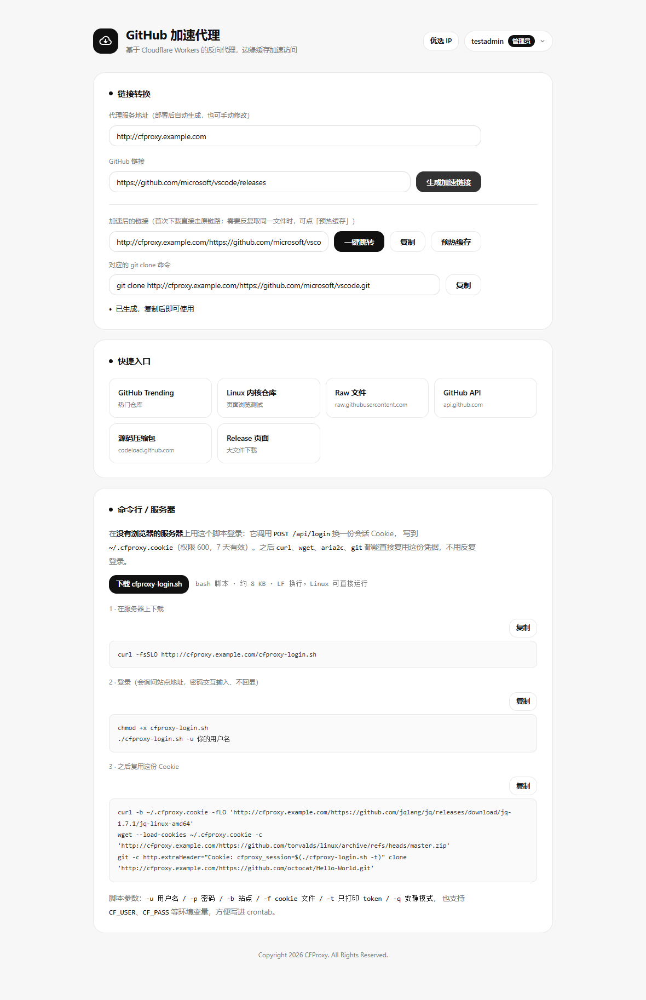
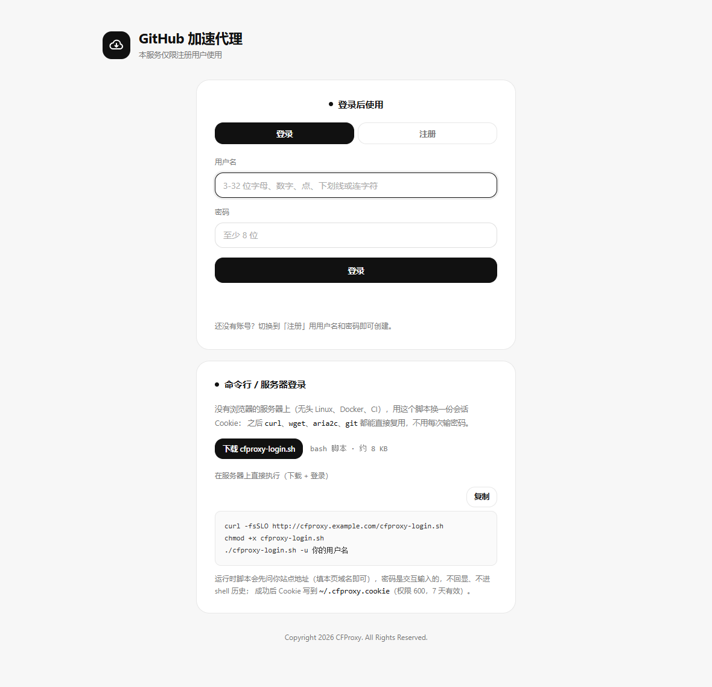
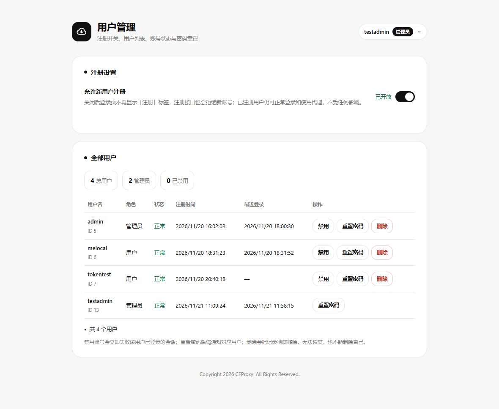
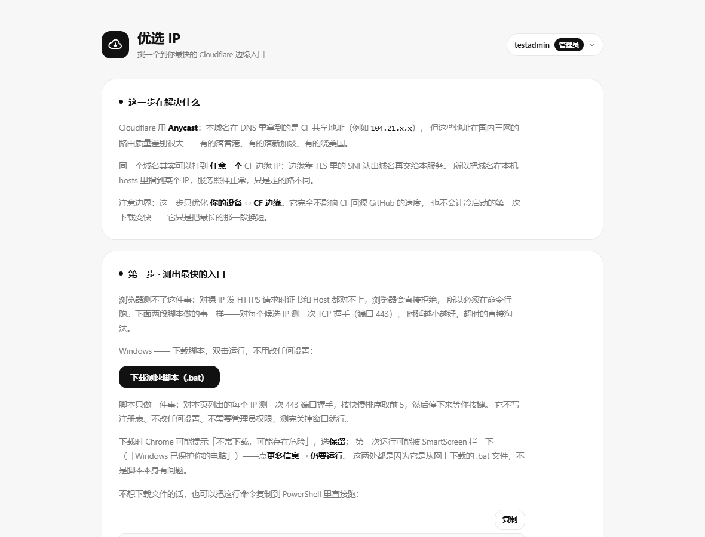
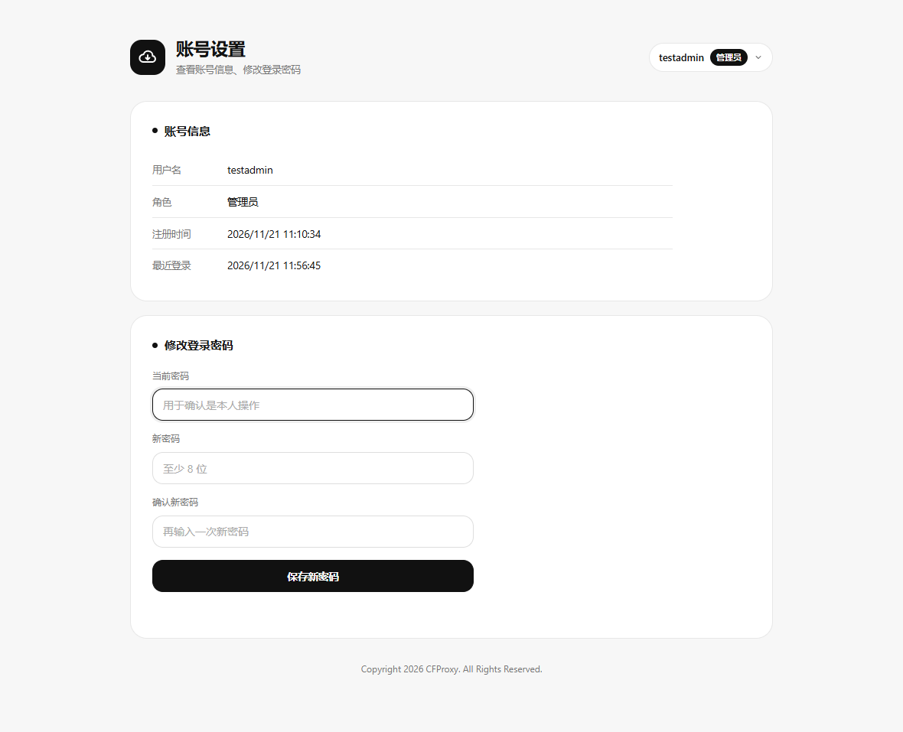

# cfproxy · GitHub 加速代理

基于 **Cloudflare Workers** 的 GitHub 反向代理：把 `https://github.com/...` 前面拼上自己的域名，请求就走 Cloudflare 边缘到 GitHub，下载资源在边缘缓存，重复下载不再回源。

自带完整用户系统（注册 / 登录 / 改密 / 禁用 / 删除）、首次部署初始化、管理员控制台，以及一个给**无浏览器服务器**用的登录脚本。

- 运行时：Cloudflare Workers + D1 + 静态资源（Assets）
- 测试：`npx vitest run` → 76 项通过

---

## 它解决什么

```text
① 设备请求      https://你的域名/https://github.com/user/repo
② 边缘命中缓存  直接返回，不回源
③ 未命中        回源 GitHub，响应顺带写进边缘缓存，下次直接命中
```

国内直连 GitHub 常见的问题（页面打不开、`raw` 超时、Release 下载龟速）都发生在最后一段链路上。把入口换到 Cloudflare 边缘之后，这一段变成「你的设备 ↔ 就近 CF 节点」，剩下的回源由 CF 的骨干网承担。

---

## 功能

**代理**

- 支持两种写法：`https://域名/https://github.com/user/repo` 与 `https://域名/?url=https://raw.githubusercontent.com/...`
- 页面重定向由 Worker 手动处理并重写 `Location`，链接不会跳出代理域名
- 下载类资源（Release / `codeload` / 对象存储）在 Worker 内部跟随重定向，浏览器只看到干净的原始链接，不会暴露带签名的临时 URL
- 稳定的 `cacheKey`（剥离每次都变的签名参数）让边缘缓存真正命中；内容不可变的 Release 资产缓存 **1 年**，其余可缓存主机 **1 天**
- 保留 `Content-Length` / `Accept-Ranges` / `Content-Range`，支持断点续传与多线程下载
- `GET /__warm?url=...` 手动预热，把整份文件先写进边缘缓存
- 域名白名单，不做开放代理

**用户与权限**

- 密码 PBKDF2-SHA256（10 万次）+ 16 字节随机盐，只存哈希
- 会话是 HMAC-SHA256 签名 Cookie，7 天有效，`HttpOnly` + `SameSite=Lax`
- 每次请求按 uid 回查数据库，所以**禁用账号 / 改角色 / 删用户立即生效**，不用等 Cookie 过期
- 首次部署通过 `/init.html` 输入初始化密钥创建唯一管理员，成功后接口永久失效
- 管理员可关闭注册、禁用/启用、重置密码、删除用户

**命令行**

- `cfproxy-login.sh`：登录换 Cookie，写成 Netscape 格式供 `curl` / `wget` / `aria2c` / `git` 复用
- 另有「优选 IP」页，测出到你最快的 Cloudflare 边缘地址并生成 hosts 行

---

## 页面示例

> 截图取自本地实例，命令里的地址会随部署地址自动变化。

### 主页 · 链接转换

粘贴 GitHub 链接即生成加速地址与 `git clone` 命令，下载资源可一键预热到边缘缓存。



页头右侧是当前账号的胶囊菜单（个人中心 / 管理控制台 / 退出登录），页面底部是给服务器用的命令行区块。

### 登录页

登录 / 注册两用。管理员关闭注册后，标签栏整体隐藏，页面只保留登录。



下半部分是「命令行 / 服务器登录」卡片：下载脚本 + 可复制的三行命令。

### 用户管理（`/admin`，仅管理员）

注册开关、用户列表、禁用 / 重置密码 / 删除。自己那行不显示禁用与删除，避免把自己锁在门外。



### 优选 IP（`/ip.html`）

对候选的 Cloudflare 边缘 IP 逐个测 TCP 握手，挑最快的写进 hosts，解决「域名解析到的那个 IP 恰好在绕路」的问题。



### 账号设置（`/me`）

查看账号信息、修改密码。



---

## 快速开始（本地）

需要 Node.js 20+。

```bash
git clone https://github.com/puzechuan/cfproxy.git
cd cfproxy
npm install

# 建一个本地 D1 并建表（--local 只写本地 .wrangler 状态）
npx wrangler d1 migrations apply cfproxy-db --local

npm run dev          # 默认 http://127.0.0.1:8787
```

打开 <http://127.0.0.1:8787/init.html>，填初始化密钥与管理员账号即可开始用。

> 仓库里的 `INIT_KEY_SHA256` 是作者自己部署时用的摘要，**自建前先换成你自己的**（生成方法见下面「部署」第 2 步），否则你不知道能通过校验的明文是什么。

常用命令：

```bash
npm run dev        # 本地开发（wrangler dev）
npm run deploy     # 部署到 Cloudflare
npm test -- run    # 跑一遍测试
```

---

## 部署到 Cloudflare

### 1. 准备数据库

```bash
npx wrangler d1 create cfproxy-db
```

把输出里的 `database_id` 填到 `wrangler.jsonc` 的 `d1_databases[0].database_id`（仓库里写的是作者那套部署的 id，必须换掉）。

### 2. 设置初始化密钥

初始化密钥只在 `/init.html` 里输入一次，仓库里存的是它的摘要：

```bash
printf '%s' '你的明文密钥' | shasum -a 256     # macOS / Linux
# Windows PowerShell:
#   [BitConverter]::ToString([Security.Cryptography.SHA256]::Create().ComputeHash(
#     [Text.Encoding]::UTF8.GetBytes('你的明文密钥'))).Replace('-','').ToLower()
```

把得到的 64 位小写 hex 填进 `wrangler.jsonc`：

```jsonc
"vars": {
  "INIT_KEY_SHA256": "把这里换成你自己的摘要"
}
```

想更稳妥，可以不写进配置文件，改在控制台把它配成 **Secret** 同名变量覆盖。

### 3. 建表并部署

```bash
npx wrangler d1 migrations apply cfproxy-db --remote
npx wrangler deploy
```

### 4. 初始化

打开 `https://<你的域名>/init.html`，输入第 2 步的明文密钥 + 管理员用户名密码。成功后该页面立即失效，其他用户可从登录页自行注册（管理员可在控制台关闭注册）。

### 5. 绑定自定义域名（可选）

控制台 → Workers & Pages → 选中 `cfproxy` → **Settings → Domains & Routes → Add → Custom Domain**，填自己的域名即可（域名需已托管在同一个 Cloudflare 账号下）。

### 6. 接自动构建（可选）

在控制台把仓库连上 Workers Builds，之后 `main` 有新提交就自动构建上线，不必再手动 `wrangler deploy`。

---

## 用法

### 网页

打开站点，粘贴任意 GitHub 链接：

```text
输入  https://github.com/microsoft/vscode/releases
输出  https://你的域名/https://github.com/microsoft/vscode/releases
```

### git

```bash
git clone https://你的域名/https://github.com/user/repo.git
```

### curl / wget（需要登录态）

先换一份会话 Cookie，之后的请求都带上它：

```bash
# 下载脚本（服务器上没有浏览器也能用）
curl -fsSLO https://你的域名/cfproxy-login.sh
chmod +x cfproxy-login.sh

# 登录：依次询问站点地址、用户名、密码（密码不回显）
# Cookie 写到 ~/.cfproxy.cookie（权限 600，7 天有效）
./cfproxy-login.sh

# 之后
curl -b ~/.cfproxy.cookie -fLO 'https://你的域名/https://github.com/user/repo/releases/download/v1/x.zip'
wget --load-cookies ~/.cfproxy.cookie -c 'https://你的域名/https://github.com/user/repo/archive/refs/heads/main.zip'
```

脚本参数：

| 参数 | 说明 | 环境变量 |
| --- | --- | --- |
| `-u` | 用户名，缺省则交互询问 | `CF_USER` |
| `-p` | 密码，缺省则静默提示 | `CF_PASS` |
| `-b` | 站点地址，缺省则交互询问 | `CF_BASE` |
| `-f` | Cookie 文件，默认 `~/.cfproxy.cookie` | `CF_COOKIE` |
| `-t` | 只打印会话 token（给 git 的 `extraHeader` 用） | |
| `-q` | 安静模式，适合 cron / CI | |

> 脚本里不写死任何域名：站点地址由 `-b`、环境变量 `CF_BASE` 或交互提示给出。只跑 `./cfproxy-login.sh` 的话，脚本会挨个问站点地址、用户名、密码；写 cron 时用 `CF_BASE` 免得卡在提示上。

写进 crontab 的例子（每天续一次会话）：

```cron
0 4 * * * CF_BASE=https://你的域名 CF_USER=me CF_PASS=*** /opt/cfproxy-login.sh -q
```

### git 需要带 Cookie 时

```bash
git -c http.extraHeader="Cookie: cfproxy_session=$(./cfproxy-login.sh -t)" clone \
  'https://你的域名/https://github.com/user/repo.git'
```

### 预热大文件

```bash
curl -b ~/.cfproxy.cookie \
  'https://你的域名/__warm?url=https://github.com/user/repo/releases/download/v1/big.iso'
```

---

## 接口一览

| 方法 | 路径 | 说明 |
| --- | --- | --- |
| `GET` | `/health` | 健康检查，返回 `{ ok, service, build, time }` |
| `GET` | `/api/init-status` | 是否已初始化、注册是否开放 |
| `POST` | `/api/init` | 首次创建管理员（需初始化密钥，只能成功一次） |
| `POST` | `/api/register` | 注册 |
| `POST` | `/api/login` | 登录，`Set-Cookie` 下发会话 |
| `POST` | `/api/logout` | 退出，清除会话 |
| `GET` | `/api/me` | 当前登录用户 |
| `POST` | `/api/me/password` | 修改自己的密码 |
| `GET` | `/api/admin/users` | 用户列表（管理员） |
| `POST` | `/api/admin/toggle` | 禁用 / 启用账号 |
| `POST` | `/api/admin/reset` | 重置指定用户密码 |
| `POST` | `/api/admin/delete` | 删除用户（不能删自己） |
| `GET` `POST` | `/api/admin/settings` | 读取 / 设置注册开关 |
| `GET` | `/__warm?url=` | 把目标文件写进边缘缓存 |

页面路由：`/` 主页、`/login.html` 登录、`/init.html` 初始化、`/admin` 用户管理、`/me` 账号设置、`/ip.html` 优选 IP。

`/admin.html`、`/me.html` 这类实体文件名也在 Worker 的鉴权名单里，避免静态资源绑定把文件直接吐出去绕过登录校验。

---

## 配置项

`wrangler.jsonc`：

| 项 | 说明 |
| --- | --- |
| `INIT_KEY_SHA256` | 初始化密钥的 SHA-256 摘要（小写 hex）。换密钥 = 改摘要重新部署 |
| `UPSTREAM_MIRRORS` | 可选，回源线路优选，JSON 数组，第一项优先。不配则直连 GitHub |
| `d1_databases[0].database_id` | 自己的 D1 实例 id |
| `assets.run_worker_first` | 需要先过 Worker 鉴权的路径，新增对外页面时记得加进去 |

> `UPSTREAM_MIRRORS` 换的是入口 URL：Workers 无法指定上游 IP（`cf.resolveOverride` 只对自有 zone 生效），而 `cacheKey` 仍基于原始 GitHub URL，所以换线路不会丢缓存。

---

## 目录结构

```text
cfproxy/
├─ src/
│  ├─ index.js          代理主逻辑：目标解析、白名单、重定向、缓存、预热、页面鉴权
│  └─ auth.js           用户系统：注册 / 登录 / 会话 / 管理接口 / 初始化
├─ public/
│  ├─ index.html        主页：链接转换、快捷入口、命令行区块
│  ├─ login.html        登录 / 注册
│  ├─ init.html         首次初始化
│  ├─ admin.html        用户管理（对外地址 /admin）
│  ├─ me.html           账号设置（对外地址 /me）
│  ├─ ip.html           优选 IP + hosts 生成
│  ├─ app.css           全站样式（含用户菜单、代码块、表格）
│  ├─ app.js            共用脚本：CF.api / CF.userBar / CF.copyText
│  └─ cfproxy-login.sh  无浏览器登录脚本
├─ migrations/
│  └─ 0001_init.sql     users / settings 表
├─ test/index.spec.js   vitest 测试
├─ docs/images/         README 用截图
└─ wrangler.jsonc       Worker / D1 / Assets 配置
```

---

## 缓存与限制

| 项 | 值 |
| --- | --- |
| 不可变资产（Release、`codeload`、对象存储）边缘缓存 | 1 年 |
| 其他可缓存主机（raw、avatars、gist 等） | 1 天 |
| 手动预热单文件上限 | 400 MB，超出直接跳过 |
| 自动预热（首个 Range 分段触发） | 64 MB 以内，延迟 3 秒 |
| 会话有效期 | 7 天 |

- 5xx 不缓存，404 缓存 5 分钟。
- 多线程下载器每个分段各发一个 Range 时，只有从字节 0 开始的起始分段触发预热，避免同一文件被并发拉 N 次。
- Cloudflare Workers 免费计划对请求数和 CPU 时间有额度，大文件首次下载受回源速度限制；命中边缘缓存后由 CF 直接返回，不再消耗 Worker 的执行时间。

---

## 安全说明

- 密码只存 PBKDF2-SHA256（10 万次迭代）结果与随机盐，不存明文。
- 会话 Cookie `HttpOnly` + `SameSite=Lax`，签名密钥随机生成后落 D1，多 isolate 共享同一把。
- 代理只放行固定白名单里的 GitHub 域名，不做开放代理。
- 转发到源站前会剔除 `cookie`、`cf-*`、`x-forwarded-*` 等头，避免把访问者凭据带出去。
- 初始化接口在创建管理员后永久失效，不留抢注窗口。
- 删除用户后，其会话与代理权限立即失效（按 uid 回查不到即视为未登录）。

---

## 测试

```bash
npx vitest run
```

覆盖用户系统（注册 / 登录 / 改密 / 禁用 / 删除 / 权限）、代理解析与白名单、Range 与缓存行为、页面鉴权、登录脚本可下载且为 LF 换行等，共 76 项。

---

## 已知边界

- 只代理 GitHub 相关域名，其他站点会被 400 拒绝（改 `ALLOWED_HOSTS` 可扩展）。
- 首次访问大文件时受回源速度限制，预热只是把「等待」提前，不会让链路本身更快。
- 「优选 IP」页只优化「你的设备 ↔ CF 边缘」这一段，不影响 CF 回源 GitHub 的速度。
